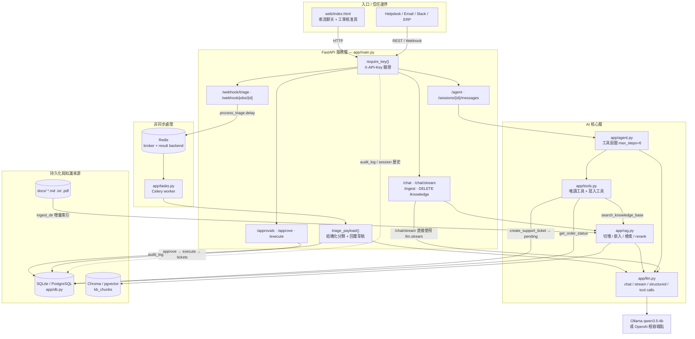
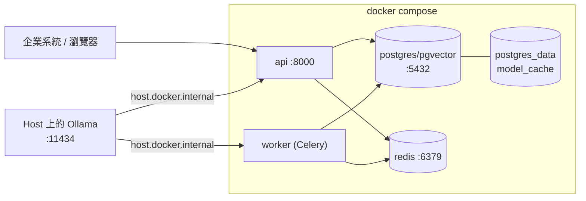

# AI 應用與整合工程師 Starter Project

一個可執行的範例專案，涵蓋四大能力：**串接 LLM API → 建立 RAG 知識庫 → 開發 AI Agent → 導入企業現有流程**。
情境：電商客服（知識庫問答 + 訂單查詢 + 工單分流）。

## 架構

```
企業系統 (Helpdesk / Email / Slack / ERP)
        │  REST / Webhook（X-API-Key 驗證）
        ▼
  app/main.py  FastAPI 服務層 ── 稽核紀錄 (audit_log)
   ├─ /chat            → app/rag.py    增量索引 → 向量搜尋 → rerank → 帶引用回答
   ├─ /agent           → app/agent.py  工具迴圈 → app/tools.py (知識庫 / 訂單DB / 建工單)
   ├─ /webhook/triage  → 結構化輸出：分類、優先級、回覆草稿、是否需人工
   └─ /chat/stream     → 串流輸出
        │
  app/llm.py   OpenAI 相容 LLM 封裝（預設本機 Ollama、串流、結構化輸出）
  app/tasks.py Celery webhook worker（Redis broker）
  web/         串流聊天與工單核准頁面
```

### 運行時架構（目前實作）



### 部署拓撲（docker-compose.yml）



## 快速開始

```bash
pip install -r requirements.txt
# Windows PowerShell：Copy-Item .env.example .env
# 先安裝 Ollama，再啟動 Ollama 並下載免費本機模型
ollama pull qwen3.5:4b
python scripts/seed_demo.py     # 建立示範訂單
python scripts/cli_demo.py      # 終端機直接試 RAG + Agent
uvicorn app.main:app --reload   # 啟動 API，文件在 /docs
pytest                          # 離線測試（不需 API key）
```

預設 LLM 使用 Ollama 的 `qwen3.5:4b`，在本機執行，不需要付費 API key。RAG 的多語嵌入模型會在首次建立索引時下載。如需改用其他 OpenAI 相容服務，設定 `LLM_BASE_URL`、`LLM_API_KEY` 與 `LLM_MODEL` 即可。

啟動服務後到 `http://localhost:8000/ui` 使用串流聊天與工單核准介面。`/chat` 與 `/agent` 支援 `session_id`，相同 session 的訊息會存入資料庫並帶入後續請求。RAG 的 `/ingest` 是增量更新：檔案未變時跳過重算，變更時更新 chunks，來源檔移除後會清掉對應索引。可用 `metadata_filter` 過濾 `source` 等欄位，也可用 `DELETE /knowledge?source=return_policy.md` 刪除來源。

### PostgreSQL、pgvector 與 webhook worker

本機快速試用預設仍採 SQLite + Chroma。設定 PostgreSQL DSN 後，向量索引會自動使用 pgvector；完整服務可用 Docker Compose 啟動 PostgreSQL/pgvector、Redis、API 與 Celery worker。Compose 會連到主機上運行的 Ollama：

```bash
docker compose up --build
```

第一次建立 pgvector 索引需要下載嵌入模型。`POST /webhook/triage` 會回傳 `job_id`，用 `GET /webhook/jobs/{job_id}` 查處理狀態。人工寫入核准流程為 `pending → approved → executed`：`POST /approvals/{id}/approve` 核准後，再呼叫 `/execute` 建立工單。

Agent 需要建立工單時只會建立待核准項目，不會立即寫入。用 `GET /approvals?state=pending` 查看，再用 `POST /approvals/{id}/approve` 核准、`POST /approvals/{id}/execute` 建立工單。每個 API request 都帶 `X-API-Key`。

RAG 黃金題集位於 `data/golden_questions.json`。執行 `python scripts/eval_rag.py` 會輸出檢索命中率與關鍵詞答案正確率；可加 `--output data/eval-result.json` 儲存明細。

```bash
curl -X POST localhost:8000/ingest -H "X-API-Key: change-me" -H "Content-Type: application/json" -d '{"directory":"docs"}'
curl -X POST localhost:8000/agent  -H "X-API-Key: change-me" -H "Content-Type: application/json" -d '{"question":"訂單 A1001 到哪了？"}'
curl -X POST localhost:8000/webhook/triage -H "X-API-Key: change-me" -H "Content-Type: application/json" \
  -d '{"ticket_id":"T-9","subject":"我要退款","body":"上週買的耳機壞了，要求全額退款，不然我要客訴"}'
```

## 八週學習與實作規劃

| 週  | 主題                | 實作（對應本專案檔案）                                                       | 完成標準                                           |
| --- | ------------------- | ---------------------------------------------------------------------------- | -------------------------------------------------- |
| 1   | LLM API 基礎        | `llm.py`：chat、串流、重試、token/延遲日誌                                   | 能解釋 temperature、max_tokens、system prompt 差異 |
| 2   | Prompt 與結構化輸出 | `extract_structured`、`/webhook/triage`                                      | 100 筆樣本輸出 schema 合格率 > 98%                 |
| 3   | RAG 基礎            | `rag.py` 切塊、嵌入、檢索                                                    | 能回答自己文件的問題並附來源                       |
| 4   | RAG 品質            | 調 chunk 大小、`max_distance`、加 rerank / hybrid search；建 20 題黃金測試集 | 有「找不到就說不知道」的行為，並有量化指標         |
| 5   | Agent 與工具        | `agent.py`、`tools.py`                                                       | 能多步驟完成「查訂單 + 查政策」                    |
| 6   | 安全與治理          | 參數化 SQL、寫入工具核准流程、prompt injection 測試、稽核                    | 惡意文件內容無法讓 Agent 越權                      |
| 7   | 企業整合            | 串真實系統：Slack / Teams / Zendesk / Jira / Email；SSO；佇列處理            | 一條真實流程端到端自動化                           |
| 8   | 部署與維運          | Docker、CI、監控、成本告警、快取                                             | 有儀表板看延遲、成本、失敗率                       |

## 導入企業流程的實務清單

1. **選對場景**：高頻、規則明確、可容錯、有人可覆核（客服分流、文件問答、報表摘要、合約初審）。
2. **先做 Copilot 再做 Autopilot**：AI 產生草稿，人按確認；穩定後再自動化低風險步驟。
3. **權限最小化**：Agent 的讀寫工具分開；金額、刪除、對外寄信一律人工核准。
4. **資料治理**：RAG 檢索要依使用者權限過濾文件；個資先遮罩再送模型。
5. **評估機制**：黃金測試集 + 上線後抽樣人工標註，每次改 prompt 或模型都跑回歸。
6. **可觀測性**：記錄輸入、檢索結果、工具呼叫、延遲、token 成本（本專案 `audit_log` 是起點）。
7. **失敗降級**：模型逾時或信心低 → 轉人工，不要讓流程卡死。

## 延伸待辦（建議依序做，也是作品集亮點）

- [x] 對話記憶：把 `history` 存 DB，依 session 帶入
- [x] 寫入工具加人工核准狀態機（pending → approved → executed）
- [x] RAG：加入 reranker、metadata 過濾、增量更新與刪除
- [x] 評估腳本 `scripts/eval_rag.py`：跑黃金題集，算命中率與答案正確率
- [x] 非同步佇列（Celery / Redis）處理 webhook，避免逾時
- [x] 增加 PostgreSQL + pgvector 後端，保留 SQLite + Chroma 本機模式
- [x] 前端：簡單聊天頁（串流）與工單審核頁

## 履歷可寫的成果句型

- 設計並實作 RAG 知識庫（Chroma + 多語嵌入），自建 20 題評測集，命中率由 X% 提升至 Y%
- 開發具工具呼叫能力的客服 Agent，整合訂單 DB 與知識庫，工單自動分流準確率達 Z%
- 建立 AI 服務的驗證、稽核與人工覆核機制，通過內部資安審查
